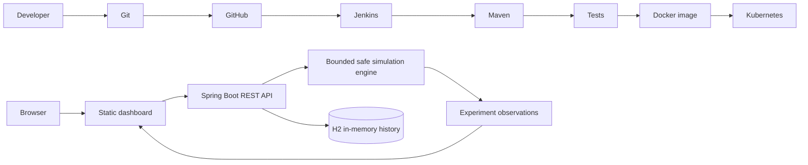
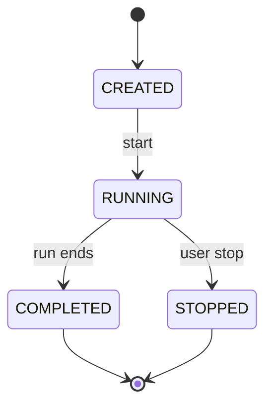

# ChaosLab

**Break Things Safely. Measure Resilience. Recover Automatically.**

ChaosLab is a learning dashboard for controlled, application-local fault simulations. It uses Java 17, Spring Boot, Maven, H2, a responsive browser UI, Docker, Jenkins, and Kubernetes manifests. Simulations are illustrative; they do not consume host CPU/memory, alter network configuration, or kill real services.

## Run on Windows

Install Java 17 and Maven. In PowerShell, from this directory:

```powershell
java -version
mvn -version
mvn spring-boot:run
```

Open http://localhost:8080. Stop with Ctrl+C. Run `mvn clean verify`; output is `target/chaoslab-1.0.0.jar`. H2 is in-memory and resets on restart.

## Features and API

- Create experiments with duration 1–60 seconds and intensity 1–100.
- Start, stop, inspect, list, and delete non-running records. Up to two runs at once.
- Scenarios: `RESPONSE_DELAY`, `CPU_STRESS`, `MEMORY_PRESSURE`, `NETWORK_LATENCY`, and `SERVICE_FAILURE`. Outputs are simulated values, not OS measurements.
- `GET /api/health`, `GET /api/dashboard`, `GET /api/experiments`, `POST /api/experiments`, `GET /api/experiments/{id}`, `POST /api/experiments/{id}/start`, `POST /api/experiments/{id}/stop`, `DELETE /api/experiments/{id}`.
- Resilience score is the rounded percent of completed experiments marked recovered. It is provisional with no completed runs and is not an industry standard.

## Architecture





Git tracks code; GitHub hosts it; Jenkins checks out, tests and packages; Maven builds; Docker packages; Kubernetes runs the container. Spring Boot serves the UI and API, experiment service creates bounded observations, and H2 stores them during process lifetime.

## Docker

Start Docker Desktop, then:

```powershell
docker build -t chaoslab:1.0.0 .
docker run --rm -p 8080:8080 chaoslab:1.0.0
```

The Jenkinsfile expects Jenkins tools named `jdk17` and `maven3`. It runs Maven verification and builds a Docker image on Unix agents with Docker. Publishing and Kubernetes deployment are not automatic because those require environment-specific registry credentials and cluster context.

## Kubernetes

For Minikube, build the image into its runtime: `minikube image build -t chaoslab:latest .`. Then:

```powershell
kubectl apply -f k8s/namespace.yaml
kubectl apply -f k8s/configmap.yaml -f k8s/deployment.yaml -f k8s/service.yaml
kubectl -n chaoslab rollout status deployment/chaoslab
kubectl -n chaoslab port-forward service/chaoslab 8080:8080
```

Visit http://localhost:8080. Inspect using `kubectl -n chaoslab get pods,svc`, `kubectl -n chaoslab logs deployment/chaoslab`, and `kubectl -n chaoslab get events --sort-by=.metadata.creationTimestamp`. Remove using `kubectl delete namespace chaoslab`. H2 history is lost on restart/pod replacement.

## CI/CD and GitHub

CI checks out, runs Maven tests and packages. A test failure blocks the Docker stage. Continuous delivery prepares a releasable artifact; continuous deployment automatically ships it. Registry publication and cluster deployment need explicit Jenkins configuration.

Create a GitHub repo, then replace the placeholder URL below:

```powershell
git init
git add .
git commit -m "Build ChaosLab resilience demo"
git branch -M main
git remote add origin https://github.com/YOUR_ACCOUNT/YOUR_REPOSITORY.git
git push -u origin main
```

Do not commit tokens. Jenkins requires GitHub checkout access, Java 17, Maven, and Docker permissions for image building.

## Project report notes

**Abstract:** ChaosLab demonstrates a web system for safely learning resilience concepts. It records user-configured scenarios and observations in an in-memory database and displays a dashboard.

**Problem and objective:** Students need visible ways to understand fault handling without disrupting machines. The objective is to model an experiment lifecycle and results within a local pipeline.

**Methodology/modules:** Browser dashboard → REST controller → validated service → bounded executor and JPA repository → H2. Jenkins verifies and packages; Kubernetes manifests use one replica, resource bounds, health probes, and a non-root user.

**Limitations/results:** CPU and memory readings are simulations, not system monitoring. H2 history is ephemeral. Run the app and capture your own UI/API evidence, Maven test output, Docker build, and cluster rollout before reporting results; no execution evidence is asserted here.

**Future work:** PostgreSQL persistence, authentication, time-series monitoring, registry publishing, and opt-in deployment automation.

## Troubleshooting

- Java mismatch: `java -version` should show 17; configure a JDK 17.
- Maven errors: check `mvn -version` uses Java 17, then retry `mvn clean verify`.
- Port 8080 busy: stop the other process or use `--server.port=8081`.
- Docker daemon unavailable: start Docker Desktop.
- Jenkins cannot find Maven: configure tools `maven3` and `jdk17`.
- Kubernetes image pull: build/load `chaoslab:latest` in the selected cluster.
- Probe failure: inspect `kubectl -n chaoslab describe pod` and pod logs.

## Verification status

Source and configuration have been created. App startup, tests, browser behavior, Docker, Jenkins, and Kubernetes deployment require execution in an environment with those tools and services; claim checks only after running them.
